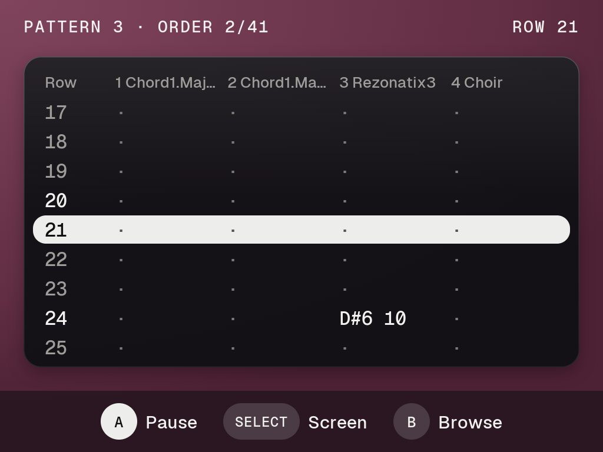
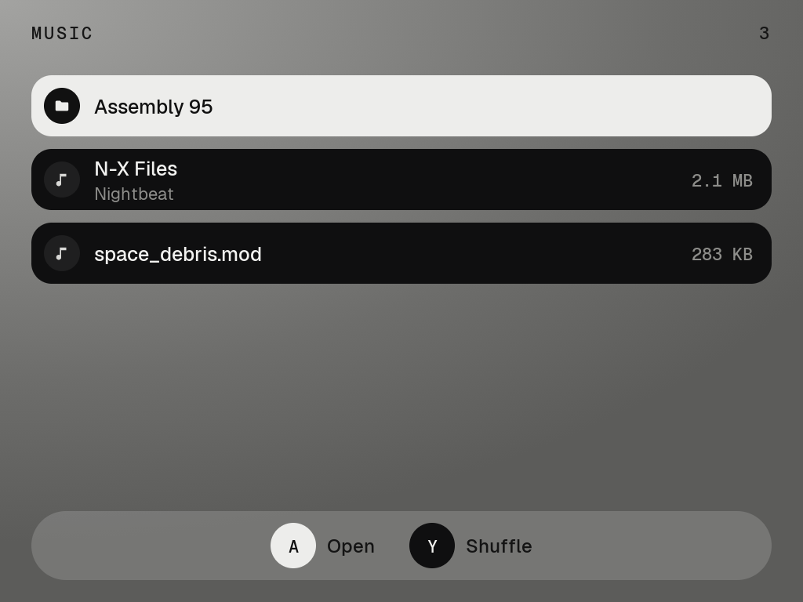
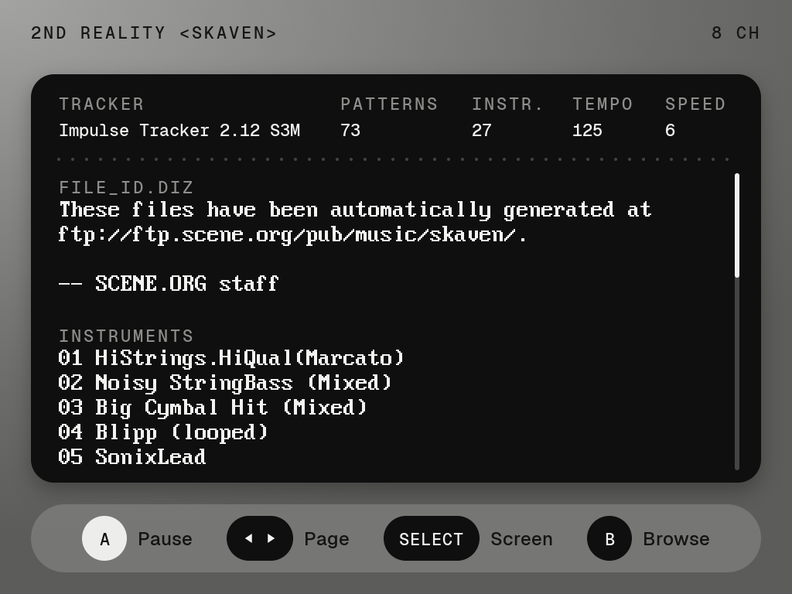
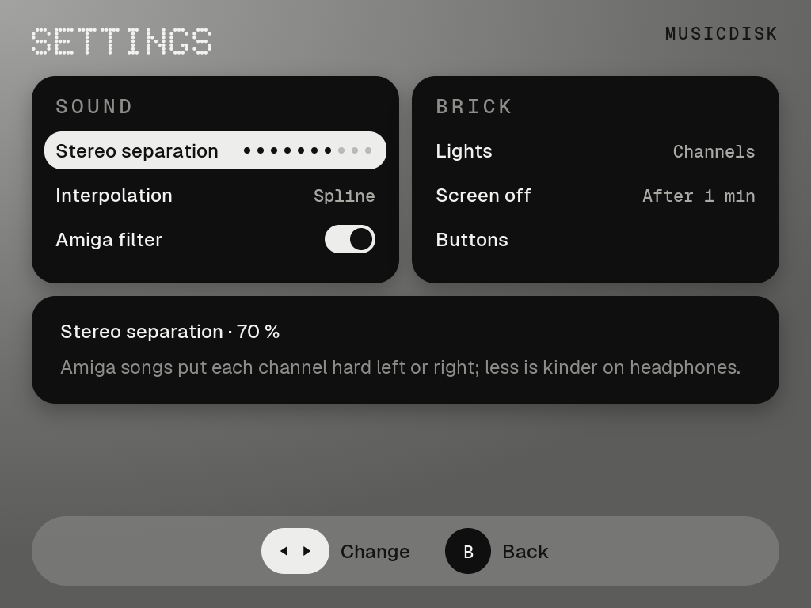

# Musicdisk – module player for NextUI

Plays MOD, S3M, XM, IT and about 90 other musicdisk formats on the TrimUI Brick (`tg5040`), from the `Music` folder
on the SD card. Playback is [libxmp](https://github.com/libxmp/libxmp).
Drawn with [Dot](https://github.com/evolver79/nextui-dotui), the shared look of Musicdisk, Kino and Tuner.

- **Now playing:** title, time, and a column of VU dots per channel. ◄ ► skip 10 s; the button that was used lights up for a moment.
- **Demo:** nine line-art demo effects that move with the song (starfield, donut, tunnel, twister, copper bars, dot
  ball, plasma contours, bobs, sine scroller), over a ticker with the
  title and the sample names. A new effect every four song positions; ◄ ► to switch.
- **Pattern:** the song's pattern as it plays, four channels at a time, named by their instruments.
- **Scopes:** real per-channel scopes, drawn from each channel's sample data at its play position.
- **Info:** the tracker, patterns, instruments, tempo and speed, then the song's `.diz` in the IBM VGA font (CP437,
  so the ASCII art looks right), the module's own message (IT, MED...) and the instrument names, where the old
  greetings live. ▲ ▼ scroll a line, ◄ ► a page.
- **Browse:** the SD card's `Music` folder and the folders in it.
  - Songs are named by their `.diz` (title and artist) when one lies beside them (`song.mod` + `song.diz`).
  - Zips with several songs (musicdisks, packs) play every song in them (L1 / R1 to skip between them); ► opens one
    like a folder, to start at any of its songs.
  - **Shuffle** (Y): every song in this folder and the folders under it, in random order.
- **Settings** (SELECT in Browse):
  - **Stereo separation** (0–100 %, 70 by default): Amiga songs put each channel hard left or right; less is kinder
    on headphones.
  - **Interpolation**: Nearest (the crunchy Amiga sound), Linear or Spline.
  - **Amiga filter**: the Amiga's low-pass filter, switched by the songs themselves.
  - **Lights**: the Brick's LEDs with the music. *Channels* (the default): a top bar LED for each channel in its own
    colour, the triggers for the channels panned left (blue) and right (red), F1 and F2 for the whole song. Or
    *Rainbow*, *Red* or *Off*. When the music stops, and when Musicdisk quits, the LEDs go back to how they were
    (an animation from LED'oh! is paused meanwhile, then carries on).
  - **Screen off**: after 30 s to 5 min without a button while a song plays (1 min by default), or at once with
    START. The music plays on; any button wakes the screen.

## Buttons

| | Player | Browse |
|---|---|---|
| A | play / pause | open folder, play song |
| B | to browse | up a folder |
| L1 / R1 | previous / next song | previous / next letter |
| ◄ ► | 10 s back / ahead (now playing; hold to keep going), effect (demo), channel page (pattern), channel (scopes), page (info) | up a folder / open a folder or zip |
| X / Y | mute / solo the selected channel | Y: shuffle the folder |
| SELECT | next screen: now playing, demo, pattern, scopes, info | settings |
| START | screen off | back to the player |
| MENU | quit | quit |

## Install

Unzip `Musicdisk.pak.zip` into a new folder on the SD card, `Tools/tg5040/Musicdisk.pak/`. Put your own modules in
`Music/` on the card.

## Build

`git clone --recursive` (Dot is a submodule in `ui/dot`). `./package.sh` builds `dist/Musicdisk.pak.zip` in an ARM64
Debian bullseye container (Docker). `build/build.sh --shots <module>` also draws every screen to `build/out/shots/`.
`./deploy.sh` copies a build to a Brick with a small private helper.

Fonts: Doto, Geist and Geist Mono (SIL OFL), from Dot; PxPlus IBM VGA 8x16 by VileR
([The Ultimate Oldschool PC Font Pack](https://int10h.org/oldschool-pc-fonts/), CC BY-SA 4.0). libxmp: MIT.
