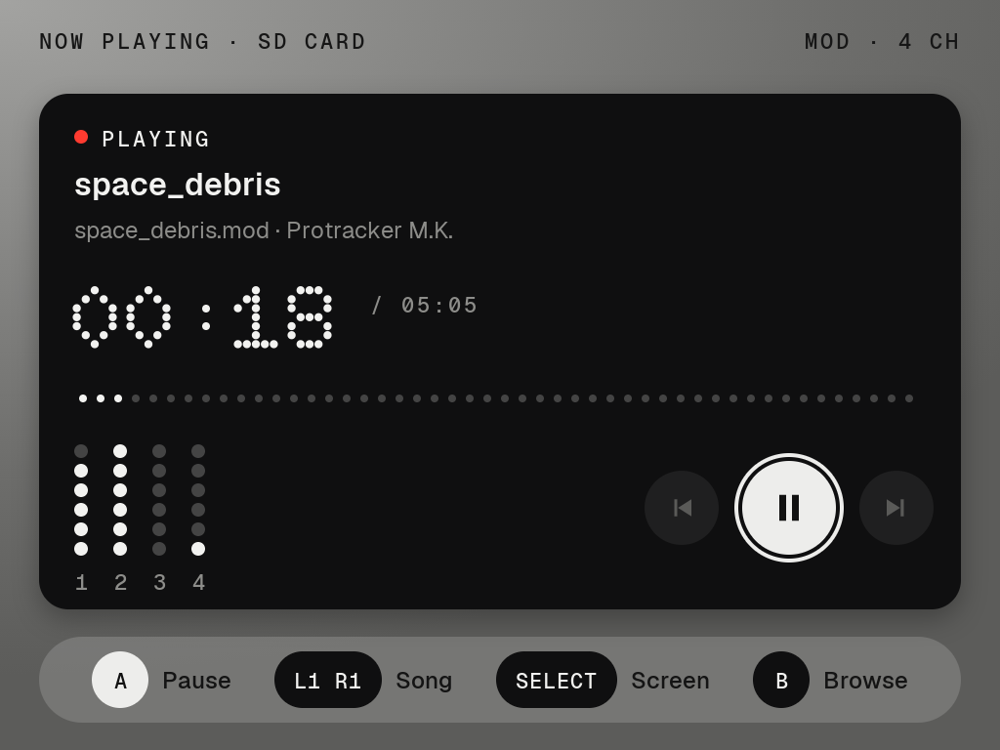
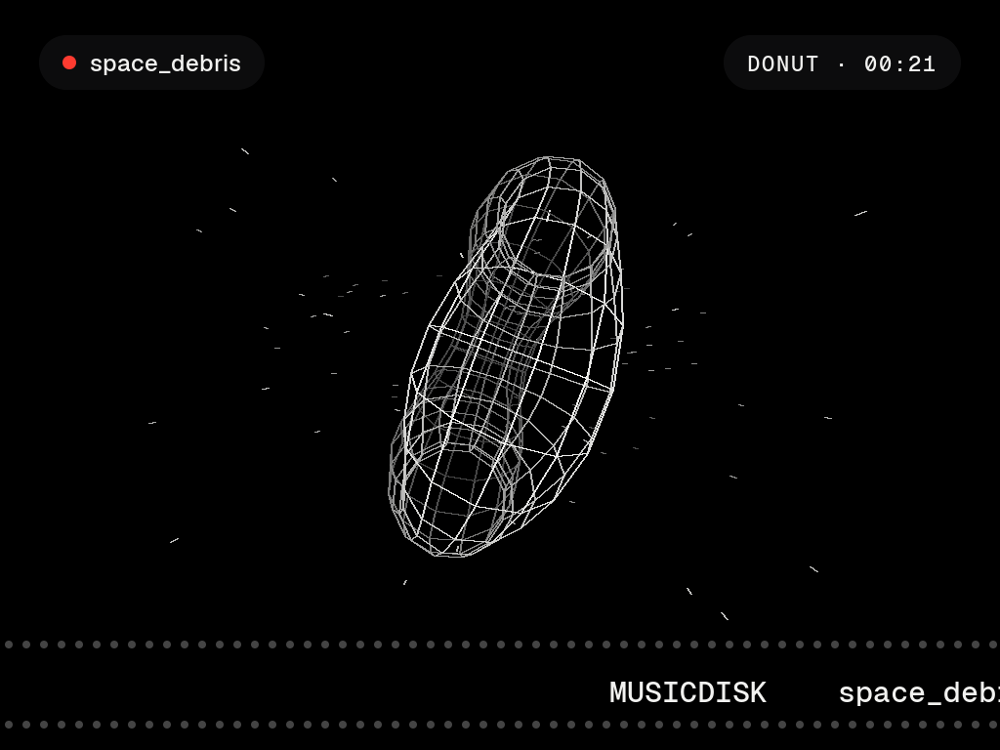
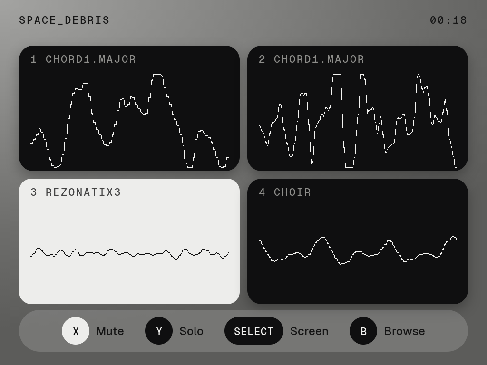
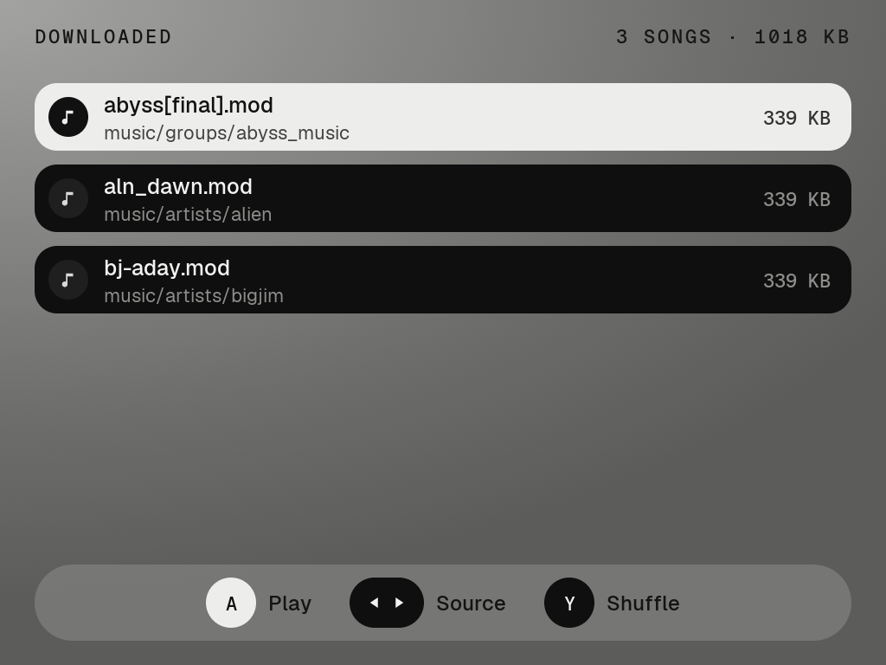
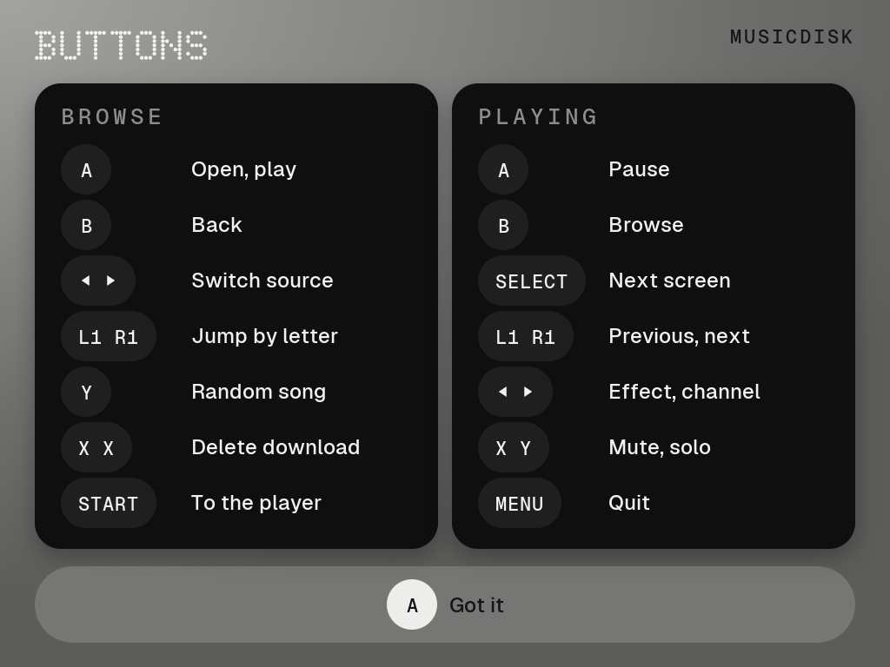

# Musicdisk – module player for NextUI

Plays MOD, S3M, XM, IT and about 90 other musicdisk formats on the TrimUI Brick (`tg5040`), from the SD card or
straight from [scene.org](https://www.scene.org)'s file mirror. Playback is [libxmp](https://github.com/libxmp/libxmp).
Drawn with [Dot](https://github.com/evolver79/nextui-dotui), the shared look of Musicdisk, Kino and Tuner.

- **Now playing:** title, time, and a VU line per channel.
- **Demo:** nine line-art demo effects that move with the song (starfield, donut, tunnel, twister, copper bars, dot
  ball, plasma contours, bobs, sine scroller), over a ticker with the
  title and the sample names. A new effect every four song positions; ◄ ► to switch.
- **Pattern:** the song's pattern as it plays, four channels at a time, named by their instruments.
- **Scopes:** real per-channel scopes, drawn from each channel's sample data at its play position.
- **Browse:** the SD card's `Music` folder, scene.org's `/pub/music/` and `/pub/parties/`, and **Downloaded**.
  - Songs are named by their `.diz` (title and artist), fetched quietly as you scroll and kept in the cache.
  - At a party, the music compo folders come first (`music`, `m4ch`, `mmul`, `msx`, `chip`...). Inside a compo,
    the party's `results.txt` gives each song its place, the list is sorted first to last, and A plays the compo
    in that order.
  - Zips with several songs (musicdisks, packs) play every song in them.
  - **Random** (Y): a random song from scene.org, and another when it ends. At parties it goes year, party, music
    compo, song. On the card and in Downloaded, Y shuffles the list.
  - **Downloaded**: every song fetched from scene.org, newest first, with the folder it came from. They play
    offline; X twice deletes one. Without internet, Musicdisk opens on Downloaded.

## Buttons

| | Player | Browse |
|---|---|---|
| A | play / pause | open folder, play song |
| B | to browse | up a folder |
| L1 / R1 | previous / next song (R1 on random: another) | previous / next letter (Downloaded: page) |
| ◄ ► | effect (demo), channel page (pattern), channel (scopes) | switch source |
| X / Y | mute / solo the selected channel | Y: random song / shuffle; X twice: delete a download |
| SELECT | next screen: now playing, demo, pattern, scopes | the buttons screen |
| START | to browse | back to the player |
| MENU | quit | quit |

## Install

Unzip `Musicdisk.pak.zip` into a new folder on the SD card, `Tools/tg5040/Musicdisk.pak/`. Put your own modules in
`Music/` on the card.

## Build

`git clone --recursive` (Dot is a submodule in `ui/dot`). `./package.sh` builds `dist/Musicdisk.pak.zip` in an ARM64
Debian bullseye container (Docker). `build/build.sh --shots <module>` also draws every screen to `build/out/shots/`.
`./deploy.sh` copies a build to a Brick with a small private helper.

Fonts: Doto, Geist and Geist Mono (SIL OFL), from Dot. libxmp: MIT.
